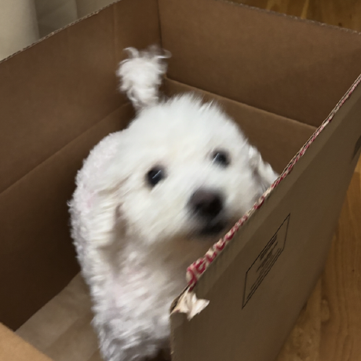

# About Me

Hello! My name is Daniel Shin. I study at the University of Washington. This page says a little about me.

Here's my dog, Ruby. She's six years old. :)

## Academics

I am majoring in Computer Science. I am currently enrolled in **ENGL396: Software Documentation**. When I graduate, 
I plan to become a software engineer.

Here is a list of my favorite classes at UW:

- [Software Design and Implementation](https://courses.cs.washington.edu/courses/cse331/)
- [Systems Programming](https://courses.cs.washington.edu/courses/cse333/)
- [Distributed Systems](https://courses.cs.washington.edu/courses/cse452/)
- *And of course, [Software Documentation](https://english.washington.edu/courses/2025/spring/engl/396/a)!*

## Programming Background

I am fairly experienced in programming. The following table summarizes my experience with different programming languages:

| Language | Experience |
|---------:|------------|
| Python | Proficient |
| Java | Proficient |
| C/C++ | Intermediate |
| JavaScript/TypeScript | Intermediate |

## Words of Wisdom

One of my favorite quotes is from Sergei Rachmaninoff:

> "Music is enough for a lifetime, but a lifetime is not enough for music."

I love music. I like to explore different genres of music, with my current interests in jazz and classical.
